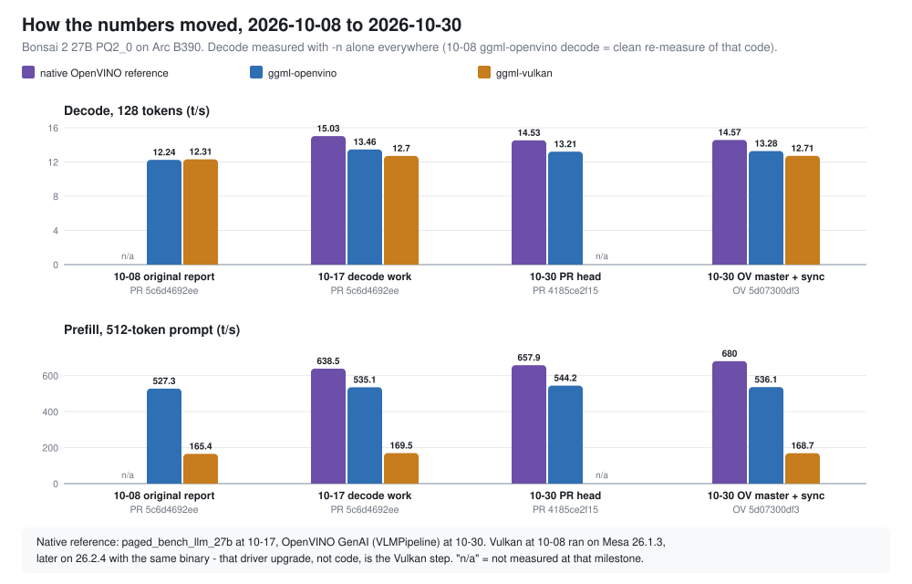

# Bonsai 2 27B on Intel GPU — results update, 2026-10-30

Latest measurements of `Ternary-Bonsai-2-27B-PQ2_0.gguf` on llama.cpp's OpenVINO backend, against
real OpenVINO GenAI and llama.cpp's Vulkan backend, compared with every earlier milestone back to
the original report of 2026-10-08.

Companion documents: `BONSAI2_TERNARY_OV_REPORT.md` (engineering detail and root-cause analysis)
and `BONSAI2_EXPLAINED.md` (background, no prior knowledge assumed).

---

## Summary

| | |
|---|---|
| **Stack** | OpenVINO **master** `5d07300df3` (PR #38460 merged as `f4e23bfdf1`) + GenAI `49237dab`; llama.cpp branch `prism_ov_ternary_sync`, synced with `ravi9/dev_backend_openvino` @ `02d71ff9e` |
| **Decode** | ggml-openvino **13.28 t/s**, GenAI **14.57** (1.10x ahead), Vulkan **12.71** |
| **Prefill, 512 tokens** | ggml-openvino **536 t/s**, GenAI **680** (1.27x), Vulkan **169** (ggml-openvino 3.18x ahead) |
| **Since the original report** | ggml-openvino decode **+8.5%** on a like-for-like basis (12.24 -> 13.28). Prefill +1.7% (pp512). |
| **Vs the native ceiling** | Decode gap **1.12x -> 1.10x** since it was first measured on 10-17 |
| **Corrections** | The original report's tg128 of 11.28 was a measurement artifact. The Vulkan gain since 10-08 comes from a Mesa driver upgrade, not code. |

Three things moved results in this period, and only one of them was code in this branch:

1. **This branch's own work** (10-17): +10.0% decode, measured as a same-session A/B.
2. **Newer OpenVINO** (PR head, then master): about −1.5% decode for ggml-openvino. GenAI prefill
   improved.
3. **Syncing with `dev_backend_openvino`**: neutral on this model (+0.4%).

---

## Latest results

Arc B390 iGPU (Xe3), OpenVINO master `5d07300df3`, all rows measured 2026-10-30, t/s. Decode
measured with `-n <N> -r 5` **on its own**; prefill with `-p 128,512 -r 3`.


| configuration | pp128 | pp512 | tg32 | tg128 |
|---|---:|---:|---:|---:|
| **OpenVINO GenAI** (`VLMPipeline`, `llm_bench`) | 258.1 | **680.0** | **14.64** | **14.57** |
| **OpenVINO GenAI**, int8 prefill | **668.6** | **740.4** | – | – |
| **ggml-openvino**, `ENABLE_KV_4D=1 KV_SLICE=0` | 236.9 | 536.1 | 13.27 | 13.28 |
| ggml-openvino, default settings | 236.2 | 541.4 | 13.14 | 13.16 |
| **ggml-openvino**, int8 prefill | 546.8 | 570.9 | – | – |
| ggml-openvino before the sync (same OpenVINO) | 236.3 | 544.7 | 13.19 | 13.23 |
| **ggml-vulkan** | 172.4 | 168.7 | 12.72 | 12.71 |
| ggml-openvino, TernOCL disabled | 1.4 | – | 1.24 | – |

- **int8 prefill** = `OV_GPU_TERNOCL_INT2_INT8_PREFILL=1`: the int2 x int8 DPAS kernel for prompts
  (M > 8) only. Weights are never unpacked and activations are quantized to int8 per 128-group.
  2.3x at pp128, 1.06x at pp512, no effect on decode.
- **GenAI** prefill t/s = prompt tokens / first-token latency at an exact 128- or 512-token prompt;
  decode is llm_bench's 2nd-token throughput. Output text checked coherent.
- **Default settings** are within 1% of the tuned configuration since the sync.

---

## Compared with earlier results



### The four milestones

| milestone | date | llama.cpp branch | OpenVINO | native reference | Vulkan driver |
|---|---|---|---|---|---|
| **M0** original report | 10-08 | `prism_ov_ternary` | PR #38460 @ `5c6d4692ee` | none | Mesa 26.1.3 |
| **M1** decode work | 10-17 | `prism_ov_ternary_kv4d` | PR #38460 @ `5c6d4692ee` | `paged_bench_llm_27b` | Mesa 26.2.4 |
| **M2** PR head | 10-30 | `prism_ov_ternary_kv4d` | PR #38460 @ `4185ce2f15` | GenAI `6a35b97b` | Mesa 26.2.4 |
| **M3** master + sync | 10-30 | `prism_ov_ternary_sync` | master @ `5d07300df3` | GenAI `49237dab` | Mesa 26.2.4 |

### ggml-openvino

| | pp128 | pp512 | tg32 | tg128 |
|---|---:|---:|---:|---:|
| M0, as published | 233.9 | 527.4 | 12.25 | <del>11.28</del> |
| M0, same code re-measured cleanly | 232.2 | 527.3 | 12.27 | 12.24 |
| M1 | 236.1 | 535.1 | 13.45 | 13.46 |
| M2 | 236.5 | 544.2 | 13.21 | 13.21 |
| **M3** | **236.9** | **536.1** | **13.27** | **13.28** |
| **M3 vs M0 (clean)** | +2.0% | +1.7% | **+8.1%** | **+8.5%** |

The published tg128 of 11.28 was an artifact: llama-bench ran the prefill cells first and
contaminated the next decode cell. Running the same M0 code with `-n` alone gives 12.24, flat with
tg32 and not the "decode degrades with depth" pattern the original report implied. Against the
published figure the gain would look like +17.7%; **+8.5% is the honest number**.

### ggml-openvino with int8 prefill

| | pp128 | pp512 |
|---|---:|---:|
| M0, as published (`OV_TERNOCL_INT2_INT8_PREFILL=1`) | 530.2 | 571.1 |
| M1 (`OV_TERNOCL_INT2_INT8_PREFILL=1`) | 549.0 | 579.7 |
| M2 (`OV_GPU_TERNOCL_INT2_INT8_PREFILL=1`) | 545.8 | 575.1 |
| **M3** (`OV_GPU_TERNOCL_INT2_INT8_PREFILL=1`) | **546.8** | **570.9** |

The variable was renamed between M1 and M2 and **each build silently ignores the other name**. With
the old name on a current build, pp128 reads the default 236 t/s with no warning.

### Native OpenVINO reference

| | pp128 | pp512 | tg32 | tg128 |
|---|---:|---:|---:|---:|
| M1, `paged_bench_llm_27b` | 241.2 | 638.5 | 14.90 | 15.03 |
| M2, GenAI | 256.2 | 657.9 | 14.63 | 14.53 |
| **M3, GenAI** | **258.1** | **680.0** | **14.64** | **14.57** |
| M1 int8 prefill | 616.3 | 693.4 | – | – |
| M2 int8 prefill | 638.2 | 715.1 | – | – |
| **M3 int8 prefill** | **668.6** | **740.4** | – | – |

M1 and M2 use **different tools**, so that step is not like-for-like. `paged_bench_llm_27b` was
the PR's own PagedAttention tool, removed from the PR before it merged; GenAI's `VLMPipeline` is
the production path. GenAI decodes about 3% slower than the old tool and prefills faster. M2 -> M3
is the same tool on newer OpenVINO: prefill +3.4% (pp512), decode flat.

### ggml-vulkan

| | pp128 | pp512 | tg32 | tg128 |
|---|---:|---:|---:|---:|
| M0, as published (Mesa 26.1.3) | 161.0 | 165.4 | 12.32 | 12.31 |
| M1 (Mesa 26.2.4) | 171.2 | 169.5 | 12.70 | 12.70 |
| **M3** (Mesa 26.2.4) | **172.4** | **168.7** | **12.72** | **12.71** |

**The Vulkan binary has not changed since 2026-10-07.** The +7% pp128, +2% pp512 and +3% decode since M0
come from `mesa-vulkan-drivers` being upgraded 26.1.3 -> 26.2.4 on 2026-10-09, the day after the
original report. The OpenCL / Level Zero stack that OpenVINO uses (`intel-opencl-icd`,
`libze-intel-gpu1` 26.31.39395.13, `libigc2` 2.36.5) did not change in this period, so the
OpenVINO rows are driver-stable across all four milestones.

---

## Gaps over time

| ratio | M0 | M1 | M2 | M3 |
|---|---:|---:|---:|---:|
| native / ggml-openvino, decode | – | 1.12x | 1.10x | **1.10x** |
| native / ggml-openvino, pp512 | – | 1.19x | 1.21x | **1.27x** |
| native / ggml-openvino, pp512 int8 | – | 1.20x | 1.24x | **1.30x** |
| ggml-openvino / Vulkan, decode | 0.99x | 1.06x | – | **1.04x** |
| ggml-openvino / Vulkan, pp512 | 3.19x | 3.16x | – | **3.18x** |

- **Decode gap to native closed 1.12x -> 1.10x.** That is all of this branch's work, net of the
  newer OpenVINO costing ggml-openvino about 1.5%.
- **The pp512 gap to native widened 1.19x -> 1.27x.** This is not a regression on our side
  (ggml-openvino pp512 stays at 527-544 throughout). The native reference improved: first from the
  tool change, then from OpenVINO master.
- **Decode against Vulkan went from a tie to a 4-6% lead.** The original report called decode a
  tie on an ~80 GB/s bandwidth wall; this machine actually peaks at 153.6 GB/s, and ggml-openvino
  now decodes faster than Vulkan even though Vulkan got its own driver uplift.

### What moved decode, step by step

Each row is a **same-session A/B**, which is the only kind of comparison here free of
machine-level drift:

| step | change | tg128 | delta |
|---|---|---|---:|
| M0 -> M1 | shape-from-mask, KV-4D, KV-slice off, GDN native state layout | 12.24 -> 13.46 | **+10.0%** |
| M1 -> M2 | OpenVINO PR `5c6d4692ee` -> `4185ce2f15` (same llama.cpp) | 13.47 -> 13.21 | −1.9% |
| M2 -> M3 | OpenVINO master, same llama.cpp | 13.21 -> 13.23 | ≈0 |
| M3 | `dev_backend_openvino` sync, same OpenVINO | 13.23 -> 13.28 | +0.4% |

---

## Why the remaining gap exists

Unchanged by anything since 10-17, and documented in detail in `BONSAI2_TERNARY_OV_REPORT.md` §4.1:

- The GPU is **~100% busy on both paths** (xe-PMU compute occupancy), so the gap is not host
  dispatch and not idle time.
- The ternary GEMVs are identical on both paths and already reach **106 GB/s**, 69% of peak.
- The whole difference is **non-GEMV graph overhead**. Its largest piece is the GatedDeltaNet
  recurrent state crossing the f32/f16 boundary every token: 48 `Convert` + 96 `Result` per
  token, ~3.4 ms. ggml owns that state in f32, so removing it needs a device-resident recurrent
  state rather than a local change.

---

## Measurement notes

- **Decode must be measured with `-n` alone on the OpenVINO backend.** `-p … -n …` contaminates
  the first decode cell (OpenVINO compiles per token count). Vulkan is immune: the combined and
  separate runs agree to 0.2%.
- **Cross-date comparisons carry machine drift.** The Vulkan step shows a driver can move results
  by several percent with identical code. Claims about *this branch's* effect come from same-session
  A/Bs only.
- **Two knobs were renamed in this period, and both old names are silently ignored:**
  `OV_TERNOCL_INT2_INT8_PREFILL` -> `OV_GPU_TERNOCL_INT2_INT8_PREFILL` (OpenVINO), and
  `GGML_OPENVINO_DISABLE_KV_SLICE=1` -> `GGML_OPENVINO_KV_SLICE=0` (llama.cpp). The latter no longer
  affects Bonsai decode.
- **On current OpenVINO, check TernOCL is live by speed.** `OV_TERNOCL_INT2_DEBUG` no longer
  exists, and the accept/reject trace needs a debug-caps build. TernOCL off is ~1.4 t/s prefill.
- **`cavusmustafa/openvino` master is a stale June mirror** without the PR. Build upstream
  `openvinotoolkit/openvino` master.

---

## Reproducing

```sh
# OpenVINO master + GenAI, built as:
#   cmake -B build-master -DOPENVINO_EXTRA_MODULES=<openvino.genai> -DENABLE_PYTHON=ON \
#         -DGPU_RT_TYPE=OCL -DENABLE_SYSTEM_OPENCL=OFF ...   (see ternocl_int2_bonsai2_from_scratch.md)
./bench_master.sh       # every row of the latest table: ggml-openvino (synced + pre-sync) and GenAI
./bench_bonsai.sh       # ggml-openvino vs ggml-vulkan
./bench_genai.sh        # GenAI only, on the PR-head build
```

GenAI needs the model directory assembled per the PR doc, step 4: the u2 IR plus the Qwen3.5
tokenizer, config and vision encoders from the Bonsai 1 template export.

---

## Next steps

1. **Device-resident GDN recurrent state** (~+4.7%, to ~14.0 t/s; would take the decode gap to
   native to ~1.04x). The hard part is correctness when llama.cpp clears and copies state slots
   through the compute graph. `GGML_OPENVINO_STATEFUL_EXECUTION=1` does not cover recurrent state.
2. **Bisect the ~1.5% decode loss** between OpenVINO `5c6d4692ee` and master.
3. **PTQ1_0 support** (Bonsai 1) in ggml-openvino. OpenVINO's GGUF frontend has it, with reference
   vectors.
4. **Prefill against GenAI** (pp512 1.27x) has widened. Worth a profile to see whether it is graph
   overhead again or something GenAI's pipeline does differently at prefill.
5. **Upstreaming** is still blocked: PQ2_0 is PrismML-fork-local, so the ternary work cannot go to
   `dev_backend_openvino` until those types land in llama.cpp master, or it goes to PrismML instead.
