# Running a ternary 27B LLM on an Intel integrated GPU: the full story

**Bonsai 2 27B (2-bit ternary weights) on llama.cpp's OpenVINO backend, from "the file does not load"
to "it compiles and runs in 16 GB of RAM".**

October 7 – November 9, 2026 · Intel Arc B390 integrated GPU (Xe3) · written for an engineer with a
general AI background who has not seen this codebase.

All 29 diagrams are in `diagrams/` and are generated by `make_diagrams.py` from the measured numbers.

---

## TL;DR

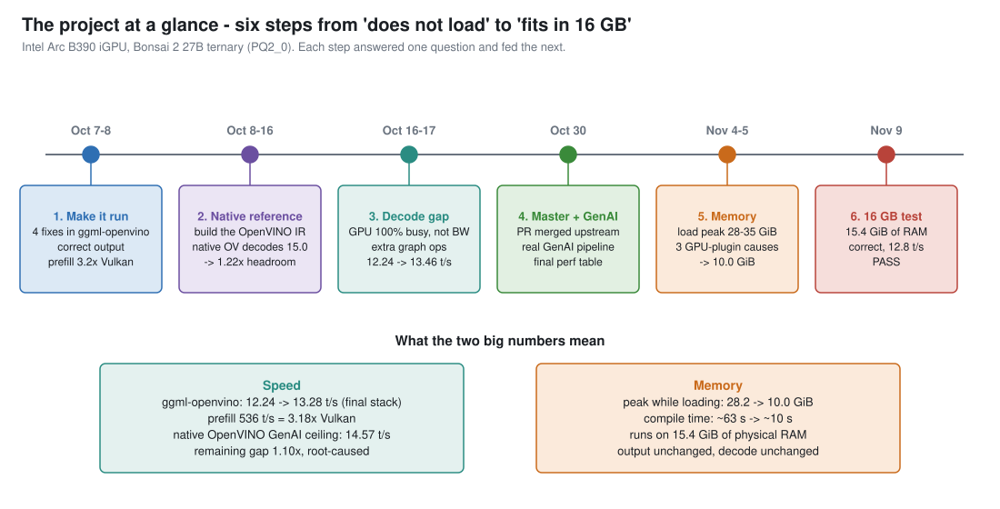

| | |
|---|---|
| **The model** | Bonsai 2 27B: a 27-billion-parameter hybrid-attention LLM whose big weight matrices hold only the values −1, 0 and +1. It is 7.2 GB on disk instead of ~54 GB at fp16. |
| **The goal** | Run it through llama.cpp's **OpenVINO backend** ("ggml-openvino") on an Intel integrated GPU, using new 2-bit GPU kernels (**TernOCL**, OpenVINO PR #38460). Make it fast, and make it fit on a **16 GB** laptop. |
| **Step 1: make it run** | 4 fixes in ggml-openvino (161 lines). Correct output. Prompt processing **3.2× faster than Vulkan**. Without the TernOCL kernels the model runs **167× slower**, so they are required. |
| **Step 2: native reference** | Built a native OpenVINO version of the model as a speed ceiling. It decodes **15.0 t/s** against our 12.25, which disproved the belief that we were limited by memory bandwidth. |
| **Step 3: decode gap** | The GPU is 100% busy in both paths. The ternary kernels are equally fast in both. The gap is **~10 ms per token of extra small graph ops**. Four changes: decode **12.24 → 13.46 t/s (+10%)**. |
| **Step 4: final stack** | On OpenVINO master with real OpenVINO GenAI: ggml-openvino decodes **13.28 t/s** (GenAI 14.57, Vulkan 12.71) and prefills **536 t/s** (GenAI 680, Vulkan 169). |
| **Step 5: memory** | Loading peaked at **28–35 GiB** although the model runs in ~7. The cause was not a generic overhead but **three specific GPU-plugin problems**. Fixed: peak **28.2 → 10.0 GiB**, compile **~63 s → ~10 s**, identical output and speed. |
| **Step 6: 16 GB test** | With RAM physically limited to 15.4 GiB: correct output, no out-of-memory kill, 12.8 t/s. **It fits.** |

---

## Part I: Background

### 1. Concepts used throughout

If you know LLM inference, skim this. Every later section relies on these ideas.

- **Quantization / bits per weight (bpw).** Storing weights with fewer bits than fp16 (16 bpw). Fewer
  bits means a smaller model and less memory traffic per token, at some cost in accuracy.
- **Prefill vs decode.** *Prefill* processes the whole prompt at once (many tokens per call). The
  weights are reused across tokens, so it is **compute-bound**. Measured as `pp512` = prompt processing
  of 512 tokens, in tokens/second. *Decode* generates one token at a time. Every weight is read once
  per token, so it is usually **memory-bandwidth-bound**. Measured as `tg128` = text generation of
  128 tokens.
- **GEMM vs GEMV.** Matrix × matrix (prefill) vs matrix × vector (decode). Different kernels are best
  for each.
- **Integrated GPU (iGPU).** The GPU has no memory of its own and uses system RAM. Two things follow:
  memory bandwidth is shared with the CPU, and "GPU memory" competes with everything else in RAM.
  That second point is why section 5 of Part II exists.
- **llama.cpp / ggml.** llama.cpp is the popular C++ LLM runtime. Its tensor library *ggml* expresses
  each forward pass as a graph of ops (`MUL_MAT`, `RESHAPE`, …). A *backend* executes that graph on
  some hardware.
- **OpenVINO.** Intel's inference runtime. A model is an `ov::Model` graph, or an *IR* file on disk.
  `compile_model` turns it into an executable for a device. The *GPU plugin* does that for Intel GPUs:
  graph transformations, fusions, kernel selection, uploading weights.
- **TernOCL.** The OpenCL kernels for ternary (2-bit) matmuls added by OpenVINO PR #38460, merged into
  OpenVINO master in late October 2026.
- **OpenVINO GenAI.** Intel's own LLM pipeline on top of OpenVINO. It reads an IR directly, with no
  llama.cpp involved. We use it as the **native ceiling**: the best this GPU and these kernels can do.

### 2. The software stack

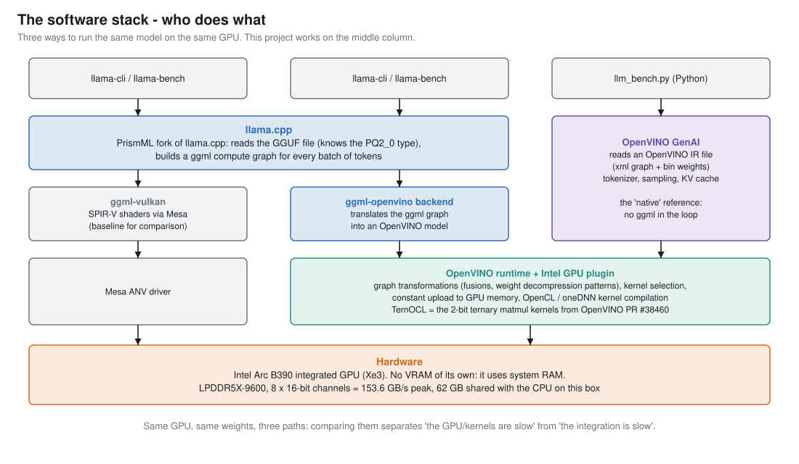

We compare three paths on the **same GPU with the same weights**. This is the main methodological
idea of the project. If ggml-openvino and native GenAI run the same kernels on the same GPU, any
speed difference is caused by the *integration*, not the hardware or the kernels. And Vulkan, a
completely different backend, shows whether OpenVINO is worth using at all.

### 3. The model

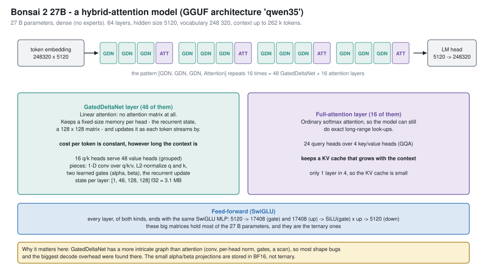

Bonsai 2 27B declares the architecture `qwen35`: 64 layers, hidden size 5120, a 248 320-token
vocabulary and up to 262 k tokens of context. It is a **hybrid**:

- **48 GatedDeltaNet (GDN) layers.** This is *linear attention*. Instead of comparing each token with
  every earlier token, each head keeps a fixed-size 128 × 128 "memory" matrix (the **recurrent
  state**) and updates it once per token. The cost per token stays constant, which is how the model
  affords a 262 k context.
- **16 full-attention layers** (every 4th layer) with a normal KV cache, for exact long-range look-ups.
- Every layer ends in the same **SwiGLU MLP** (5120 → 17408 → 5120). These matrices hold most of the
  parameters, and they are the ternary ones.

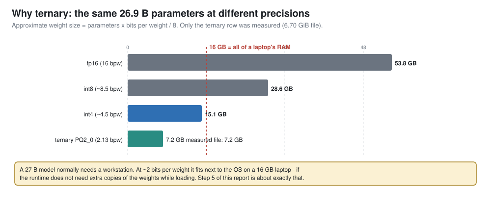

Why ternary is attractive: 26.9 B parameters at 2.13 bpw is **7.2 GB**. At fp16 it would be ~54 GB.
That makes a 27 B model plausible on a 16 GB laptop, if nothing in the runtime needs extra copies
while loading. Part II, step 5 shows that this condition was not met at first.

### 4. How a ternary weight is stored (PQ2_0)

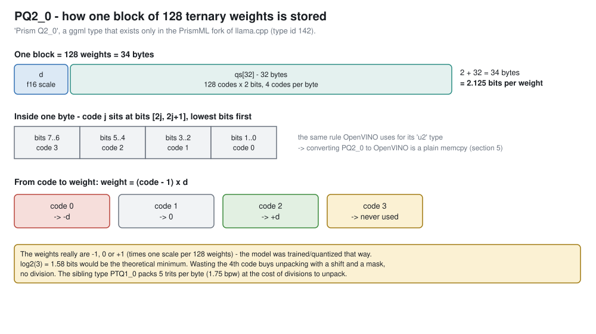

The file uses **PQ2_0** ("Prism Q2_0"), a weight type that exists only in the **PrismML fork** of
llama.cpp. Stock llama.cpp cannot read the file at all. Each block holds 128 weights: one fp16 scale
`d` plus 32 bytes of 2-bit codes. The weight is `(code − 1) × d`, so codes 0/1/2 mean −d/0/+d and
code 3 is unused. That is 34 bytes per 128 weights = **2.125 bpw**.

### 5. The twist: a Hadamard rotation in front of every ternary matmul

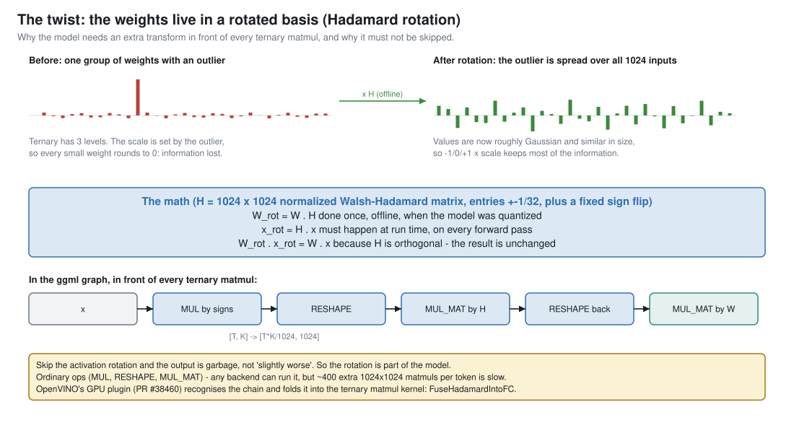

Ternary has only three levels. A single large weight (an *outlier*) in a group would set the scale,
and everything else would round to zero. So before quantizing, the model's authors rotated the
weights by a **Hadamard matrix**, which spreads any outlier across all 1024 inputs. Because the
matrix is orthogonal, the result stays the same **only if the activations are rotated the same way
at run time**. Skip that and the output is garbage. In the ggml graph this appears as a few ordinary
ops in front of every ternary matmul. OpenVINO's GPU plugin can fold them into the matmul kernel
(`FuseHadamardIntoFC`).

### 6. How the OpenVINO backend runs a model

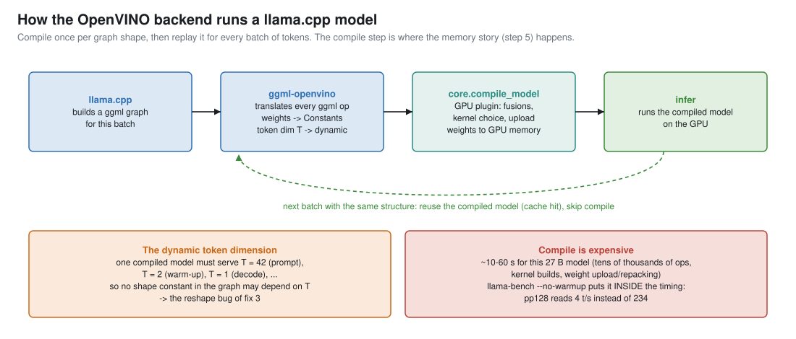

llama.cpp builds a ggml graph. ggml-openvino translates it into an `ov::Model`, in which weights
become Constants and the **token dimension is dynamic**. The model is compiled once and then reused
for every batch with the same structure. Two consequences come up again and again:

1. One compiled model must serve 42 tokens, 2 tokens and 1 token alike. **No shape baked into the
   graph may depend on the token count.**
2. **Compiling is expensive.** For this model it took tens of seconds and, as step 5 shows, most of
   the memory.

---

## Part II: The work, step by step

### Step 1 (Oct 7–8): make it run

**Workspace.** We forked llama.cpp from **PrismML's fork** (branch `prism`), because only that fork
knows PQ2_0 and generates the Hadamard runtime. We replaced its OpenVINO backend wholesale with the
newest one from `ravi9/dev_backend_openvino`. The only adaptation needed was a small backend-API
version difference (v2 vs v3). OpenVINO itself was built from source with PR #38460 (TernOCL)
fetched in.

Four fixes were needed, 161 lines across 7 files of `ggml/src/ggml-openvino`.

#### Fix 1: read PQ2_0 as OpenVINO `u2`

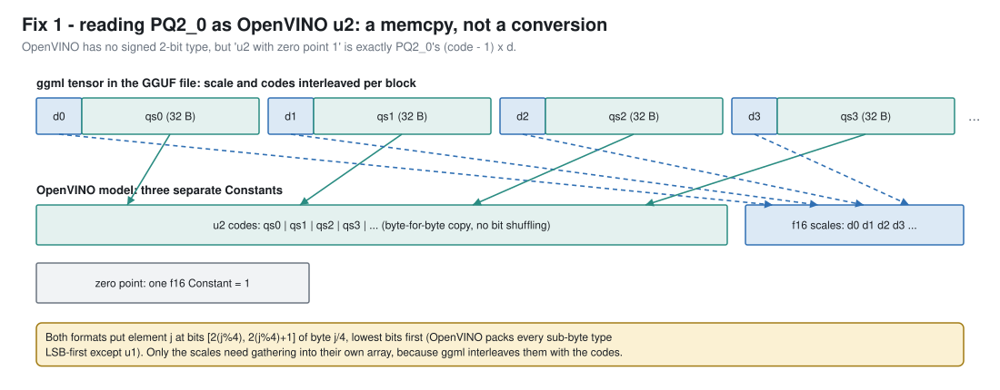

OpenVINO has no signed 2-bit type. But "unsigned 2-bit (`u2`) with a zero point of 1" is
mathematically identical to PQ2_0, and **the bit packing is identical too**. So the "conversion" is a
plain `memcpy` of the code bytes, plus gathering the scales into their own array.

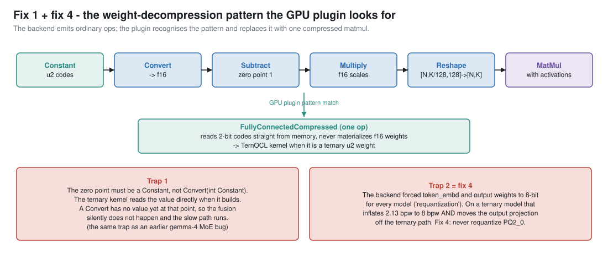

The backend emits the standard "weight decompression" pattern: Convert → Subtract zero point →
Multiply scale. The GPU plugin recognises it and replaces it with one compressed matmul that runs
the TernOCL kernel. One detail matters: the zero point has to be a *Constant*. A Convert of an
integer constant silently breaks the fusion.

#### Fix 2: the joint q/k normalization in GatedDeltaNet

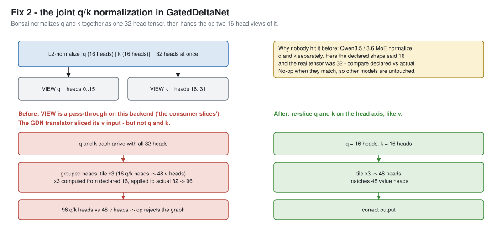

This model normalizes q and k as one 32-head tensor and hands the GDN op two 16-head *views* of it.
The backend treats views as pass-throughs ("the consumer slices"), and the GDN translator sliced only
`v`. So q and k arrived with 32 heads each, the grouped-head tiling turned them into 96, and the op
rejected the graph. The fix is to re-slice q and k too. It is a no-op for models that normalize them
separately, which is why the bug had never been hit.

#### Fix 3: a reshape that baked in the token count

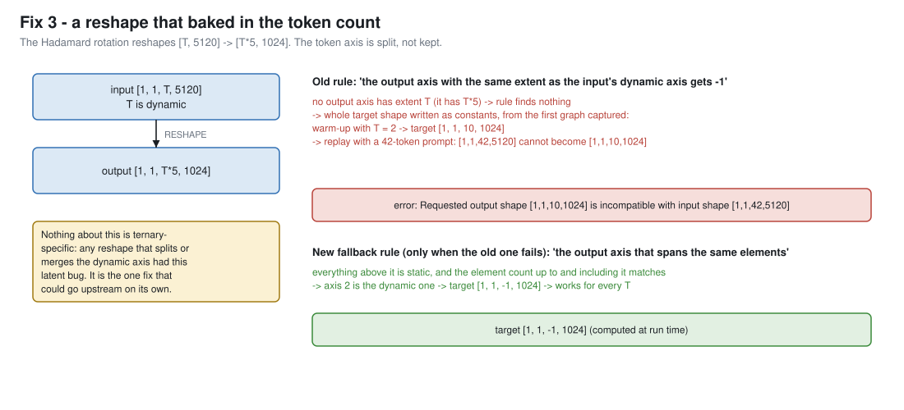

The Hadamard rotation reshapes `[T, 5120]` into `[T·5, 1024]`, which *splits* the token axis. The
backend's rule for "which output axis is the dynamic one" only recognised axes that keep their
size. It found none, so it wrote the entire target shape as constants taken from the first
(2-token) graph, and the 42-token prompt then failed. A fallback rule now matches the axis that
spans the same elements. This fix is fully general and could go upstream on its own.

#### Fix 4: never requantize ternary weights

The backend forced the embedding and output weights to 8-bit for every model. On a ternary model
that inflates them from 2.13 to 8 bits and pushes the output projection off the ternary path. PQ2_0
is now excluded.

#### The debugging lesson

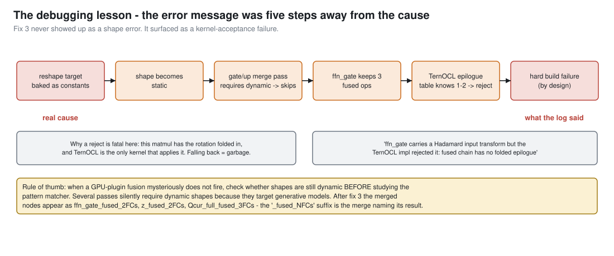

Fix 3 never showed up as a shape error. It surfaced five steps later as *"the TernOCL impl rejected
it: fused chain has no folded epilogue"*. Each step in that chain was correct behaviour on its own.
Chasing the message leads into the kernel's acceptance rules, five steps away from the cause.
**When a fusion mysteriously does not fire, check whether the shapes are still dynamic first.**

#### How the ternary kernels pick a strategy

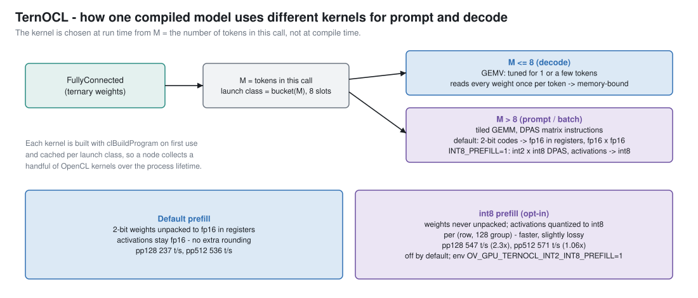

TernOCL chooses its kernel at run time from the number of tokens in the call: a GEMV for decode,
a tiled GEMM for prompts. There is an optional *int8 prefill* mode
(`OV_GPU_TERNOCL_INT2_INT8_PREFILL=1`) that never unpacks the 2-bit weights and quantizes the
activations to int8. It is 2.3× faster at 128-token prompts and slightly lossy, so it is off by
default.

#### Step 1 result

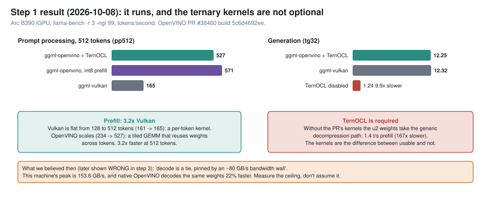

Correct output, identical to the CPU reference. Regression suite 8079/8084, and the 5 failures exist
on the unmodified backend too. Prefill is 3.2× Vulkan. Decode looked like a tie with Vulkan, and we
**wrongly** concluded that both were stuck on a hardware bandwidth wall. Step 2 disproved that.
Pushed as branch `prism_ov_ternary`.

### Step 2 (Oct 8–16): build a native OpenVINO reference

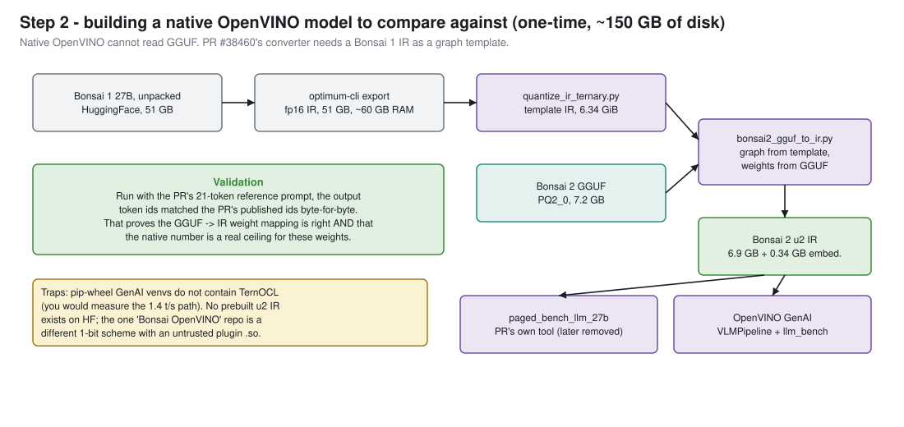

To know how fast this model *can* run on this GPU, we needed it in native OpenVINO form. Native
OpenVINO cannot read GGUF. The PR's converter takes the graph structure from an IR of the sibling
model Bonsai 1 (a 51 GB download, exported to a 51 GB fp16 IR, then quantized to ternary) and the
weights from our GGUF. With the PR's reference prompt, the converted model reproduced the PR's
published output tokens byte-for-byte. That is the end-to-end proof that the weight mapping is right.

Result: **native OpenVINO decodes 15.03 t/s, against our 12.25**, on the same GPU with the same
weights. So there was headroom, and "we are at the hardware limit" was false.

Two traps from this step:

- The pip-installed GenAI environments carry a stock OpenVINO without TernOCL. Using them would have
  measured the 1.4 t/s path and made native OpenVINO look catastrophically slow.
- No prebuilt ternary IR exists on HuggingFace. The one "Bonsai OpenVINO" repository uses a different
  1-bit scheme and ships an untrusted plugin binary, so we did not use it.

### Step 3 (Oct 16–17): find and shrink the decode gap

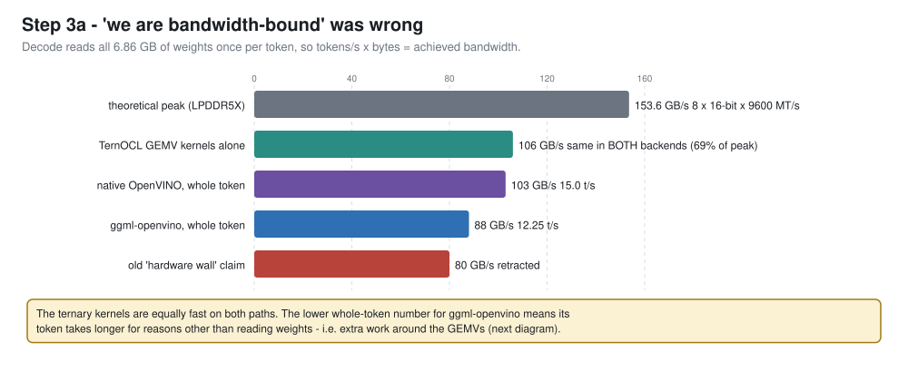

First we measured the real ceiling. This machine's memory peaks at **153.6 GB/s**, not ~80. The
ternary GEMV kernels alone reach **106 GB/s in both backends**. So the kernels are not the
difference.

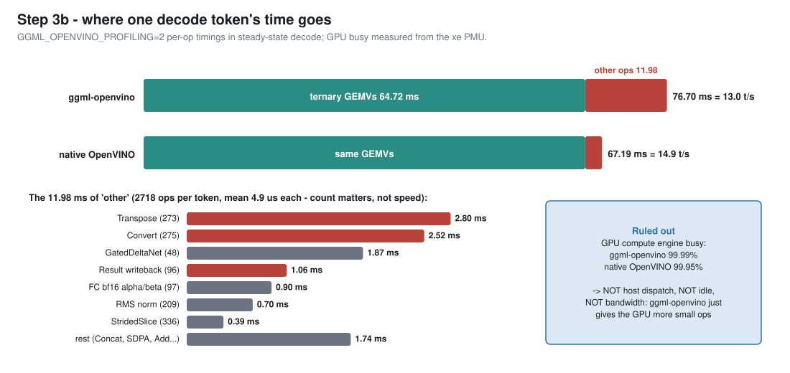

Per-op profiling of one decode token gave the answer: **64.7 ms of ternary GEMVs, identical in both
paths, plus 12 ms of other ops in ggml-openvino versus ~2.5 ms natively**. The GPU's own counters
show it 100% busy in both cases. So this is not the CPU failing to feed the GPU, and not bandwidth.
ggml-openvino simply asks the GPU to run ~2700 small ops per token. Each costs ~5 µs, so their
*number* matters more than their speed.

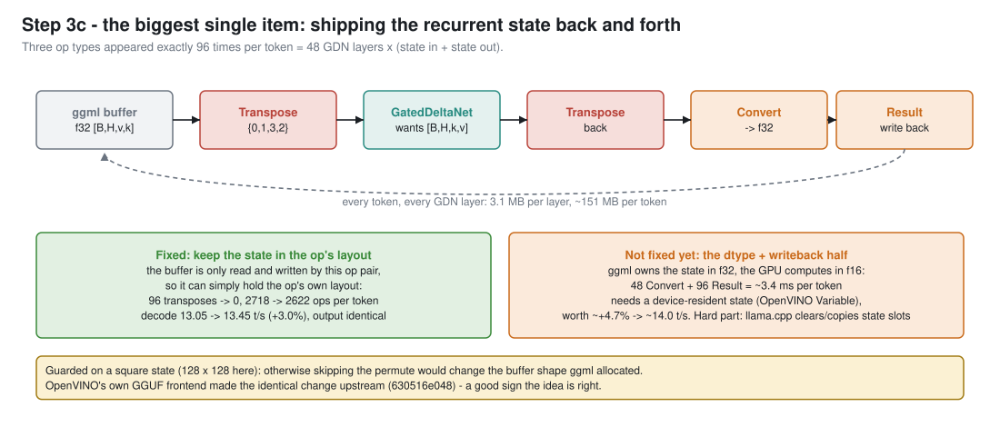

The biggest single item was found by grouping ops by *cause* instead of by type. Three op types each
appeared exactly 96 times per token, which is 48 GDN layers × 2. The recurrent state was transposed
into the op's layout and back again on every token, converted to f32, and written back. We kept the
state in the op's own layout, which removes 96 transposes per token and gives **+3.0%**. OpenVINO's
own GGUF frontend later made the identical change upstream. The f32-conversion and write-back half
remains (~3.4 ms/token) and needs a GPU-resident state. That is listed as a next step.

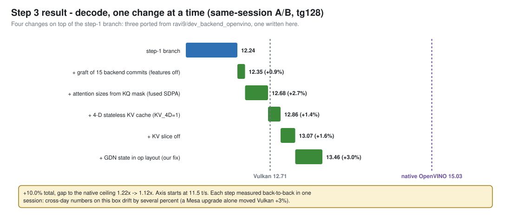

Together with three backend improvements ported from `dev_backend_openvino`, decode went
**12.24 → 13.46 t/s (+10%)**, and the gap to native went **1.22× → 1.12×**. Prefill was unchanged:
it is dominated by the TernOCL GEMM, which was already good.

Two measurement traps from this step:

- `llama-bench -p … -n …` runs the prompt tests first, and that contaminated the next decode number.
  It produced a "decode gets slower with context" story that was false and has been retracted.
  Measure decode on its own.
- A GPU-busy sample taken just *after* generation ends reads ~14% and looks exactly like a host
  bottleneck.

Pushed as branch `prism_ov_ternary_kv4d`.

### Step 4 (Oct 30): OpenVINO master, real GenAI, backend sync

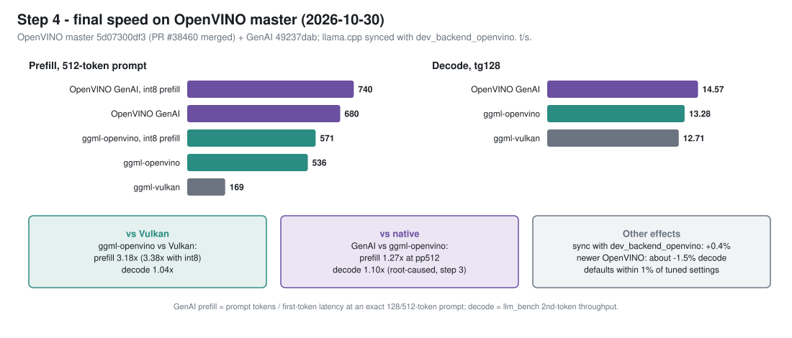

PR #38460 was merged into OpenVINO master. We rebuilt everything on master, including real
**OpenVINO GenAI**, which replaced the PR's own benchmark tool (removed before the merge). We also
re-synced the backend with the latest `dev_backend_openvino`. That sync was neutral on this model
(+0.4%). Final numbers are in the diagram above. Remaining gaps to native: decode 1.10×, prefill
1.27× at 512 tokens.

Two more traps:

- Between PR revisions **the TernOCL environment variables were renamed**, and each build silently
  ignores the other spelling. With the old int8-prefill name on a new build, the speed simply stays
  at the default.
- **Vulkan got 3–7% faster with an identical binary**, because the Mesa driver was upgraded the day
  after the first report. Only same-session A/B comparisons count as evidence that a change helped.

Pushed as branch `prism_ov_ternary_sync`.

### Step 5 (Nov 4–5): make it fit in 16 GB

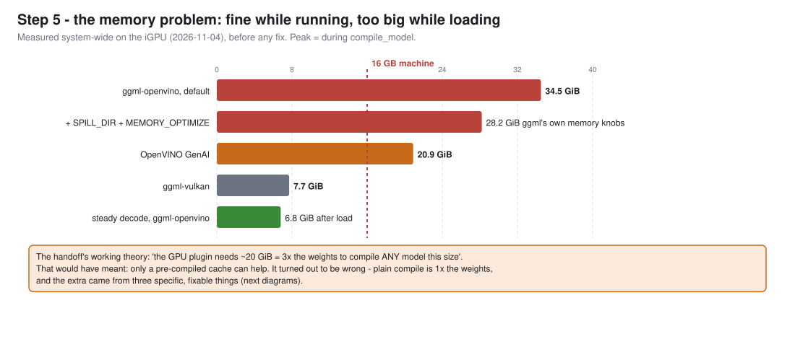

While running, ggml-openvino needs only ~7 GiB. **While loading** it peaked at 28–35 GiB, which is
impossible on a 16 GB machine. The previous investigation had concluded that "the GPU plugin needs
~3× the weights to compile any model this size", which would leave only a precompiled cache as a
way out. That conclusion turned out to be wrong.

#### First, measure memory correctly

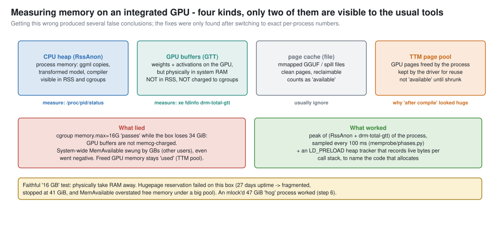

On an integrated GPU, GPU buffers live in system RAM but **do not appear in the process's RSS and
are not charged to cgroups**. So a `memory.max=16G` cgroup "passes" while the machine loses 34 GiB.
The machine-wide "available" number was also unreliable: other users on this shared box moved it by
gigabytes, and freed GPU pages stay "used" in the driver's page pool. The numbers that worked were
**per-process CPU heap (`RssAnon`) plus the GPU driver's exact per-process count (`drm-total-gtt`)**,
sampled every 100 ms. A small `LD_PRELOAD` heap tracker recorded live bytes per call stack, which
pointed to the code responsible for each allocation.

#### A clean reproducer

We dumped the exact graph ggml-openvino compiles and compiled it with a tiny C++ program that uses
plain OpenVINO, with no llama.cpp involved. It reproduced the same 27.9 GiB peak. The same plugin
compiling GenAI's version of the model, with TernOCL off, used **1× the weights and no transient at
all**. So there was no generic 3× overhead. The extra memory came from three specific causes.

#### Cause 1 (~9.4 GiB): the token embedding was decompressed

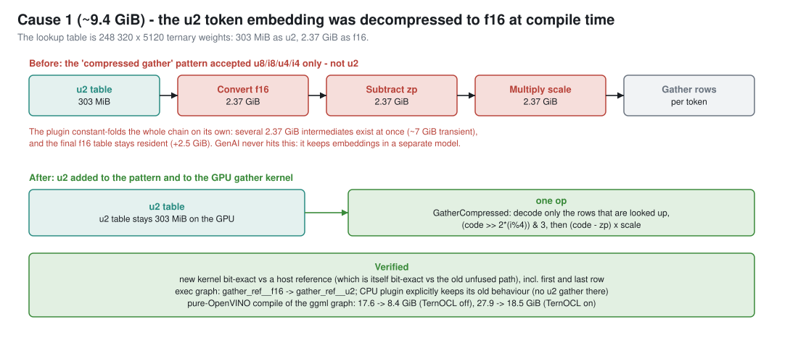

The pattern that fuses "decompress + look up rows" into one op accepted 8-bit and 4-bit tables but
not 2-bit. So the plugin decompressed the whole 248 320 × 5120 embedding table to f16 at compile
time: several 2.37 GiB intermediates at once, with one kept for good. GenAI never hits this because
it keeps embeddings in a separate model. **Fix:** u2 support in the pattern and in the GPU gather
kernel. The new kernel is bit-exact against an independent reference, and the CPU plugin keeps its
old behaviour.

#### Cause 2 (~5 GiB): all weight conversions ran in one batch

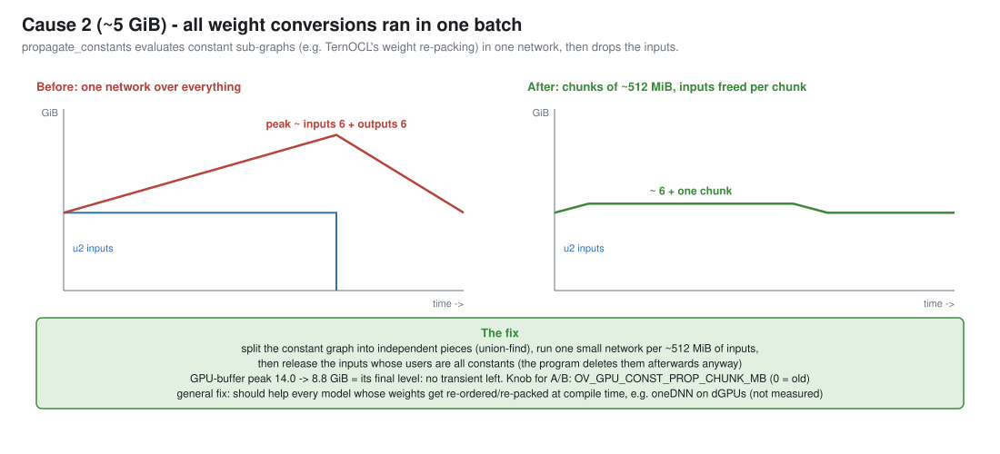

At compile time the plugin evaluates "constant" subgraphs, for example TernOCL repacking each
weight into its kernel layout, in **one** internal network. So all ~6 GiB of original weights and
all ~6 GiB of repacked copies existed at the same time. **Fix:** split the work into independent
pieces, process them in chunks of ~512 MiB, and free each chunk's originals right away. The GPU
buffer peak dropped to exactly its final level, with no transient left.

#### Cause 3 (~4.2 GiB and ~48 s): host copies of merged weights

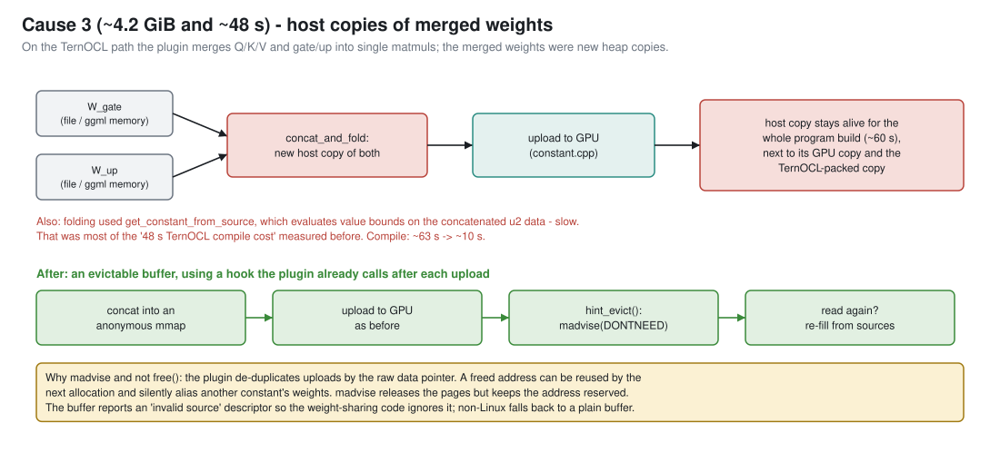

On the TernOCL path the plugin merges Q/K/V and gate/up into single matmuls. The merged weights were
new copies in CPU memory, and they stayed alive for the entire ~60 s program build, alongside their
GPU copies. Creating them also ran a slow value-bounds evaluation over the 2-bit data, and that
accounted for most of the "48 s TernOCL compile time" seen earlier. **Fix:** build the merged weights
in a buffer that is released right after upload, through a hook the plugin already calls. The
release uses `madvise` rather than `free()`. The plugin de-duplicates uploads by memory address, so
a freed and reused address could silently alias another weight. The buffer can rebuild itself from
the original weights if anything reads it later.

#### Result

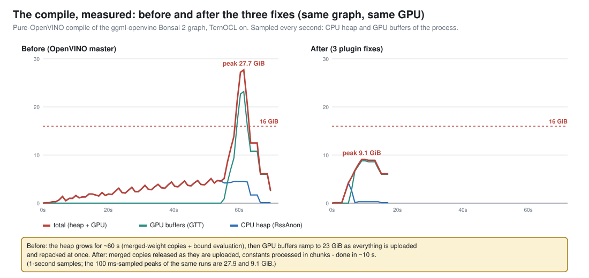

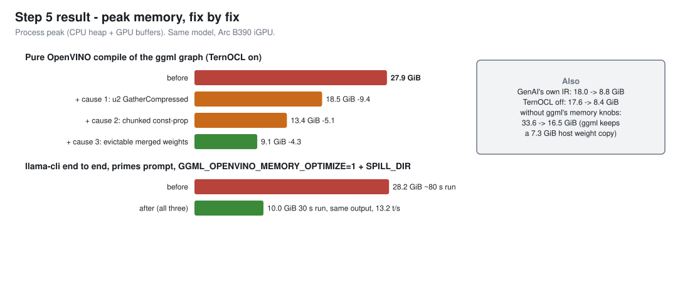

Peak while loading: **28.2 → 10.0 GiB** end to end, compile **~63 s → ~10 s**. The output is
identical: the greedy answer to "List the first 10 prime numbers" is still exactly
`2, 3, 5, 7, 11, 13, 17, 19, 23, 29`. Decode is unchanged at 13.2 t/s. GenAI's own model benefits too
(18.0 → 8.8 GiB).

These three fixes are in OpenVINO's GPU plugin, not in llama.cpp. They are an **uncommitted
prototype** (`memprobe/ov_compile_memory_fixes.patch`, 8 files), built in a separate debug tree.

### Step 6 (Nov 9): a faithful 16 GB test

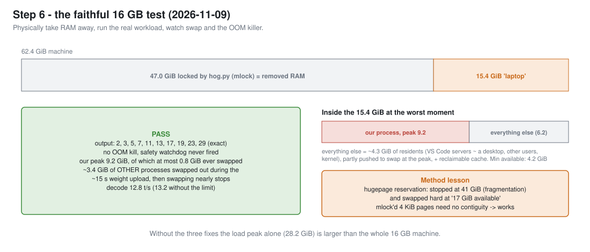

A real test needs RAM physically taken away, because cgroups cannot see GPU buffers. The first
method, reserving huge pages, failed. After 27 days of uptime, memory on this box was too fragmented
to reserve more than 41 GiB, and the machine swapped while reporting 17 GiB available. The second
method worked: a helper process that locks 47 GiB of ordinary pages, leaving **15.4 GiB for
everything**, about what a 16 GB laptop really has after the iGPU's share. A watchdog would have
killed our process before the kernel's OOM killer had to pick a victim.

Result: **pass**. The output was exact, there was no OOM kill, and decode ran at 12.8 t/s (13.2
unconstrained). The cost is that during the ~15 s weight upload about 3.4 GiB of other processes was
pushed to swap. Only ≤ 0.8 GiB of our own process ever was. Without the fixes, the loading peak alone
(28.2 GiB) is larger than the entire machine.

---

## Part III: Takeaways

### What generalizes

1. **Compare against a native ceiling on the same hardware.** It turned "decode is a hardware tie"
   into "we have 22% headroom", and it separated kernel problems from integration problems in every
   later step.
2. **Measure the ceiling instead of assuming it.** The "80 GB/s wall" was off by almost 2×, and the
   "3× generic compile overhead" did not exist.
3. **Group profile data by cause, not by op type.** "96 = 48 layers × 2" exposed the state
   round-trip, which was invisible in a per-op-type table.
4. **Error messages can sit several steps away from their cause.** Check shape dynamism before
   debugging a fusion pattern.
5. **On integrated GPUs, measure memory per process with the driver's own counter.** RSS, cgroups
   and machine-wide "available" all misled us.

### Measurement traps (each one cost real time)

| trap | symptom | do instead |
|---|---|---|
| `llama-bench --no-warmup` on the OpenVINO backend | pp128 reads 4 t/s instead of 234 (the compile is inside the timing) | always warm up |
| `llama-bench -p … -n …` together | first decode cell is too low, giving a false "slower with depth" story | measure `-n` on its own |
| renamed environment variables | old name silently ignored, numbers do not move | check the build's strings, verify by speed |
| driver upgrades between days | Vulkan +3–7% with an identical binary | only trust same-session A/Bs |
| GPU-busy sampled after generation ends | ~14% busy, looks like a host bottleneck | wait for load, calibrate against prefill |
| editing dead code | "optimization" changes nothing, op counts identical | check which translator actually runs |
| cgroup memory limits on an iGPU | GPU buffers not counted, false "fits" | physically limit RAM |
| hugepage reservation on a long-running box | fragmentation caps it, swaps at "17 GiB available" | mlock a regular-page hog |
| `test-backend-ops` with a mismatched device name | "0/0 tests passed" plus overall OK | check the test count |

### Where things are and what is next

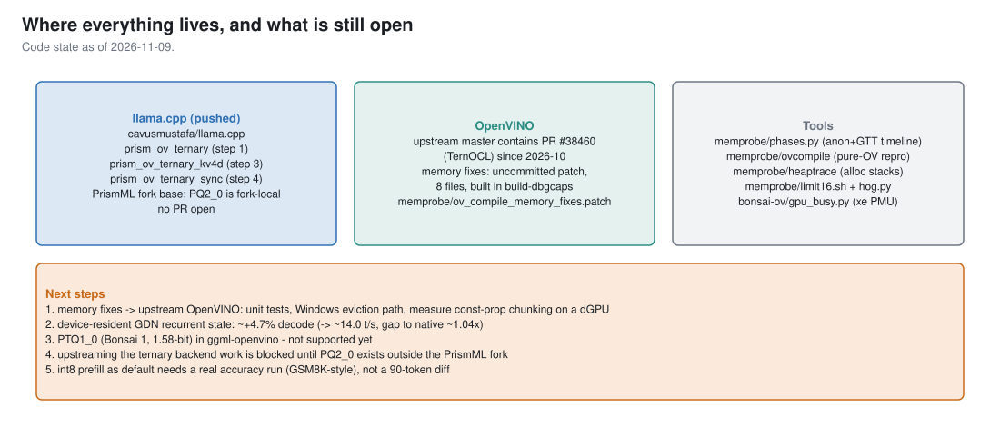

| | |
|---|---|
| llama.cpp work | `cavusmustafa/llama.cpp`: `prism_ov_ternary` → `_kv4d` → `_sync` (pushed, no PR; upstreaming is blocked because PQ2_0 exists only in the PrismML fork) |
| OpenVINO memory fixes | uncommitted: `memprobe/ov_compile_memory_fixes.patch`, built in `openvino/build-dbgcaps` |
| Detailed engineering docs | `bonsai-ov/BONSAI2_TERNARY_OV_REPORT.md`, `bonsai-ov/BONSAI2_EXPLAINED.md`, `bonsai-ov/BONSAI2_RESULTS_20261030.md`, `HANDOFF_20261105_gpu_compile_memory_fixed.md` |
| Tools | `memprobe/phases.py`, `memprobe/ovcompile.cpp`, `memprobe/heaptrace/`, `memprobe/limit16.sh` + `hog.py`, `bonsai-ov/gpu_busy.py` |

---

## Appendix: useful switches

| variable | effect |
|---|---|
| `GGML_OPENVINO_DEVICE=GPU` | run the OpenVINO backend on the GPU |
| `GGML_OPENVINO_ENABLE_KV_4D=1` | 4-D stateless KV cache (+1.4% decode; needs OpenVINO ≥ 2026.5) |
| `GGML_OPENVINO_MEMORY_OPTIMIZE=1` + `GGML_OPENVINO_SPILL_DIR=<dir>` | drop ggml's host weight copies; required for 16 GB machines |
| `OV_GPU_TERNOCL_INT2_INT8_PREFILL=1` | faster, slightly lossy prompt processing (old builds: `OV_TERNOCL_INT2_INT8_PREFILL=1`) |
| `OV_GPU_ENABLE_TERNOCL_INT2=0` | turn TernOCL off (≈167× slower prefill; diagnostics only) |
| `OV_GPU_CONST_PROP_CHUNK_MB=<n>` | prototype only: chunk size for constant propagation, `0` = original behaviour |
| `GGML_OPENVINO_PROFILING=2` | per-op timings to CSV |
| `GGML_OPENVINO_DUMP_IR=1` | write the compiled `ov::Model` as an IR (needs the GatedDeltaNet extension to read back) |
